

  <!-- title -->
  <a href="https://git.io/typing-svg">
    <picture>
      <source media="(prefers-color-scheme: dark)"
        srcset="https://readme-typing-svg.demolab.com?font=Fira+Code&weight=600&size=24&pause=1000&speed=40&color=58A6FF&width=700&height=50&center=true&lines=Hi%2C+I%27m+konlue.+Walking+in+AI+Full-Stack.&repeat=false&loop=false" />
      
    </picture>
  </a>

 

  <!-- Links -->
  
  <a href="mailto:yuxiaoyu.dev@gmail.com"><b>yuxiaoyu.dev@gmail.com</b></a>
  &nbsp;&nbsp;·&nbsp;&nbsp;
  
  <a href="https://konlue.github.io" target="_blank" rel="noopener"><b>https://konlue.github.io</b></a>

 

<h2 align="left"> Contributing to</h2>

<!-- OPEN_SOURCE_PRS:START -->

<h4 align="left"> <a href="https://github.com/apache/shenyu"><b>apache/shenyu</b></a> &nbsp;&nbsp;&nbsp;&nbsp;  <b>8.9k</b></h4>

> Java-native API gateway for service proxy, protocol conversion and API governance.

**What I did**: Bug fixes and reliability work across `admin` / `sdk` / `bootstrap` (instance heartbeats and cluster master election, Oracle compatibility, Netty event-loop lifecycle, SDK response handling), plus registry cleanup, dependency slimming and release notes. Currently working on plugin fault-tolerance eviction and K8s scaler wiring.

40 PRs&nbsp;&nbsp; 34 merged&nbsp;&nbsp; 5 open &nbsp;&nbsp;(&nbsp;click to expand)

<a href="https://github.com/apache/shenyu/pull/8098">
<picture>
  <source media="(prefers-color-scheme: dark)" srcset="./assets/apache--shenyu-8098-dark.svg">
  
</picture>
</a>
<a href="https://github.com/apache/shenyu/pull/8086">
<picture>
  <source media="(prefers-color-scheme: dark)" srcset="./assets/apache--shenyu-8086-dark.svg">
  
</picture>
</a>
<a href="https://github.com/apache/shenyu/pull/8084">
<picture>
  <source media="(prefers-color-scheme: dark)" srcset="./assets/apache--shenyu-8084-dark.svg">
  
</picture>
</a>
<a href="https://github.com/apache/shenyu/pull/8075">
<picture>
  <source media="(prefers-color-scheme: dark)" srcset="./assets/apache--shenyu-8075-dark.svg">
  
</picture>
</a>
<a href="https://github.com/apache/shenyu/pull/8035">
<picture>
  <source media="(prefers-color-scheme: dark)" srcset="./assets/apache--shenyu-8035-dark.svg">
  
</picture>
</a>
<a href="https://github.com/apache/shenyu/pull/7984">
<picture>
  <source media="(prefers-color-scheme: dark)" srcset="./assets/apache--shenyu-7984-dark.svg">
  
</picture>
</a>
<a href="https://github.com/apache/shenyu/pull/7939">
<picture>
  <source media="(prefers-color-scheme: dark)" srcset="./assets/apache--shenyu-7939-dark.svg">
  
</picture>
</a>
<a href="https://github.com/apache/shenyu/pull/7938">
<picture>
  <source media="(prefers-color-scheme: dark)" srcset="./assets/apache--shenyu-7938-dark.svg">
  
</picture>
</a>
<a href="https://github.com/apache/shenyu/pull/7925">
<picture>
  <source media="(prefers-color-scheme: dark)" srcset="./assets/apache--shenyu-7925-dark.svg">
  
</picture>
</a>
<a href="https://github.com/apache/shenyu/pull/7917">
<picture>
  <source media="(prefers-color-scheme: dark)" srcset="./assets/apache--shenyu-7917-dark.svg">
  
</picture>
</a>
<a href="https://github.com/apache/shenyu/pull/7887">
<picture>
  <source media="(prefers-color-scheme: dark)" srcset="./assets/apache--shenyu-7887-dark.svg">
  
</picture>
</a>
<a href="https://github.com/apache/shenyu/pull/7858">
<picture>
  <source media="(prefers-color-scheme: dark)" srcset="./assets/apache--shenyu-7858-dark.svg">
  
</picture>
</a>
<a href="https://github.com/apache/shenyu/pull/7850">
<picture>
  <source media="(prefers-color-scheme: dark)" srcset="./assets/apache--shenyu-7850-dark.svg">
  
</picture>
</a>
<a href="https://github.com/apache/shenyu/pull/7846">
<picture>
  <source media="(prefers-color-scheme: dark)" srcset="./assets/apache--shenyu-7846-dark.svg">
  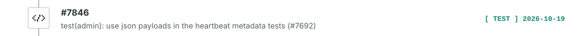
</picture>
</a>
<a href="https://github.com/apache/shenyu/pull/7844">
<picture>
  <source media="(prefers-color-scheme: dark)" srcset="./assets/apache--shenyu-7844-dark.svg">
  
</picture>
</a>
<a href="https://github.com/apache/shenyu/pull/7798">
<picture>
  <source media="(prefers-color-scheme: dark)" srcset="./assets/apache--shenyu-7798-dark.svg">
  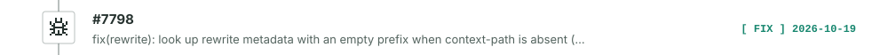
</picture>
</a>
<a href="https://github.com/apache/shenyu/pull/7797">
<picture>
  <source media="(prefers-color-scheme: dark)" srcset="./assets/apache--shenyu-7797-dark.svg">
  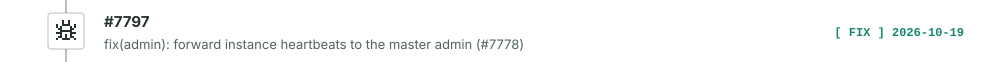
</picture>
</a>
<a href="https://github.com/apache/shenyu/pull/7786">
<picture>
  <source media="(prefers-color-scheme: dark)" srcset="./assets/apache--shenyu-7786-dark.svg">
  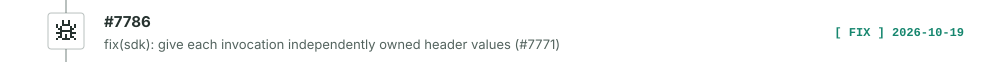
</picture>
</a>
<a href="https://github.com/apache/shenyu/pull/7782">
<picture>
  <source media="(prefers-color-scheme: dark)" srcset="./assets/apache--shenyu-7782-dark.svg">
  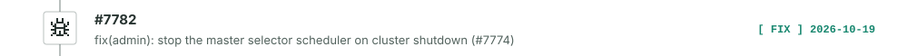
</picture>
</a>
<a href="https://github.com/apache/shenyu/pull/7780">
<picture>
  <source media="(prefers-color-scheme: dark)" srcset="./assets/apache--shenyu-7780-dark.svg">
  
</picture>
</a>
<a href="https://github.com/apache/shenyu/pull/7776">
<picture>
  <source media="(prefers-color-scheme: dark)" srcset="./assets/apache--shenyu-7776-dark.svg">
  
</picture>
</a>
<a href="https://github.com/apache/shenyu/pull/7766">
<picture>
  <source media="(prefers-color-scheme: dark)" srcset="./assets/apache--shenyu-7766-dark.svg">
  
</picture>
</a>
<a href="https://github.com/apache/shenyu/pull/7758">
<picture>
  <source media="(prefers-color-scheme: dark)" srcset="./assets/apache--shenyu-7758-dark.svg">
  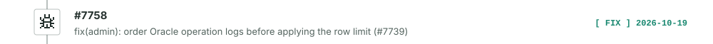
</picture>
</a>
<a href="https://github.com/apache/shenyu/pull/7756">
<picture>
  <source media="(prefers-color-scheme: dark)" srcset="./assets/apache--shenyu-7756-dark.svg">
  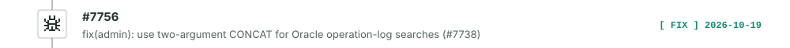
</picture>
</a>
<a href="https://github.com/apache/shenyu/pull/7754">
<picture>
  <source media="(prefers-color-scheme: dark)" srcset="./assets/apache--shenyu-7754-dark.svg">
  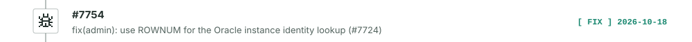
</picture>
</a>
<a href="https://github.com/apache/shenyu/pull/7746">
<picture>
  <source media="(prefers-color-scheme: dark)" srcset="./assets/apache--shenyu-7746-dark.svg">
  
</picture>
</a>
<a href="https://github.com/apache/shenyu/pull/7742">
<picture>
  <source media="(prefers-color-scheme: dark)" srcset="./assets/apache--shenyu-7742-dark.svg">
  
</picture>
</a>
<a href="https://github.com/apache/shenyu/pull/7740">
<picture>
  <source media="(prefers-color-scheme: dark)" srcset="./assets/apache--shenyu-7740-dark.svg">
  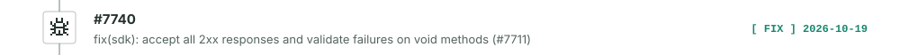
</picture>
</a>
<a href="https://github.com/apache/shenyu/pull/7729">
<picture>
  <source media="(prefers-color-scheme: dark)" srcset="./assets/apache--shenyu-7729-dark.svg">
  
</picture>
</a>
<a href="https://github.com/apache/shenyu/pull/7726">
<picture>
  <source media="(prefers-color-scheme: dark)" srcset="./assets/apache--shenyu-7726-dark.svg">
  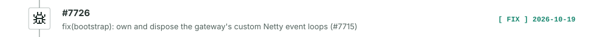
</picture>
</a>
<a href="https://github.com/apache/shenyu/pull/7722">
<picture>
  <source media="(prefers-color-scheme: dark)" srcset="./assets/apache--shenyu-7722-dark.svg">
  
</picture>
</a>
<a href="https://github.com/apache/shenyu/pull/7721">
<picture>
  <source media="(prefers-color-scheme: dark)" srcset="./assets/apache--shenyu-7721-dark.svg">
  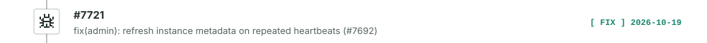
</picture>
</a>
<a href="https://github.com/apache/shenyu/pull/7710">
<picture>
  <source media="(prefers-color-scheme: dark)" srcset="./assets/apache--shenyu-7710-dark.svg">
  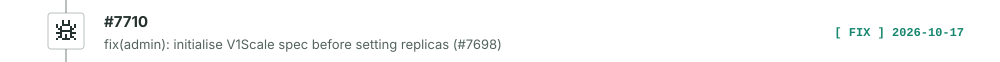
</picture>
</a>
<a href="https://github.com/apache/shenyu/pull/7699">
<picture>
  <source media="(prefers-color-scheme: dark)" srcset="./assets/apache--shenyu-7699-dark.svg">
  
</picture>
</a>
<a href="https://github.com/apache/shenyu/pull/7691">
<picture>
  <source media="(prefers-color-scheme: dark)" srcset="./assets/apache--shenyu-7691-dark.svg">
  
</picture>
</a>
<a href="https://github.com/apache/shenyu/pull/7677">
<picture>
  <source media="(prefers-color-scheme: dark)" srcset="./assets/apache--shenyu-7677-dark.svg">
  
</picture>
</a>
<a href="https://github.com/apache/shenyu/pull/7663">
<picture>
  <source media="(prefers-color-scheme: dark)" srcset="./assets/apache--shenyu-7663-dark.svg">
  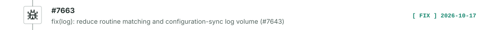
</picture>
</a>
<a href="https://github.com/apache/shenyu/pull/7642">
<picture>
  <source media="(prefers-color-scheme: dark)" srcset="./assets/apache--shenyu-7642-dark.svg">
  
</picture>
</a>
<a href="https://github.com/apache/shenyu/pull/7618">
<picture>
  <source media="(prefers-color-scheme: dark)" srcset="./assets/apache--shenyu-7618-dark.svg">
  
</picture>
</a>
<a href="https://github.com/apache/shenyu/pull/7611">
<picture>
  <source media="(prefers-color-scheme: dark)" srcset="./assets/apache--shenyu-7611-dark.svg">
  
</picture>
</a>

[View all merged PRs in apache/shenyu →](https://github.com/apache/shenyu/pulls?q=is%3Apr+author%3Akonlue+is%3Amerged)

<h4 align="left"> <a href="https://github.com/agentic-ai-java/argi"><b>agentic-ai-java/argi</b></a> &nbsp;&nbsp;&nbsp;&nbsp;  <b>130</b></h4>

> Agent Runtime and Graph Intelligence: a Java agent framework built on Spring AI, with a graph runtime, multi-agent workflows and visual administration.

**What I did**: The opt-in ToolCall argument-validation gate (local JSON Schema `$ref` expansion, resource limits), a unified tool-failure status contract, the AgentResult delivery contract with structured-output finalizer, and a fix for user-registered KeyStrategy loss during state cloning. Currently working on streaming delivery boundaries.

8 PRs&nbsp;&nbsp; 7 merged &nbsp;&nbsp;(&nbsp;click to expand)

<a href="https://github.com/agentic-ai-java/argi/pull/179">
<picture>
  <source media="(prefers-color-scheme: dark)" srcset="./assets/agentic-ai-java--argi-179-dark.svg">
  
</picture>
</a>
<a href="https://github.com/agentic-ai-java/argi/pull/173">
<picture>
  <source media="(prefers-color-scheme: dark)" srcset="./assets/agentic-ai-java--argi-173-dark.svg">
  
</picture>
</a>
<a href="https://github.com/agentic-ai-java/argi/pull/167">
<picture>
  <source media="(prefers-color-scheme: dark)" srcset="./assets/agentic-ai-java--argi-167-dark.svg">
  
</picture>
</a>
<a href="https://github.com/agentic-ai-java/argi/pull/159">
<picture>
  <source media="(prefers-color-scheme: dark)" srcset="./assets/agentic-ai-java--argi-159-dark.svg">
  
</picture>
</a>
<a href="https://github.com/agentic-ai-java/argi/pull/151">
<picture>
  <source media="(prefers-color-scheme: dark)" srcset="./assets/agentic-ai-java--argi-151-dark.svg">
  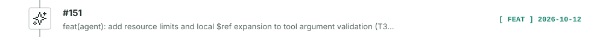
</picture>
</a>
<a href="https://github.com/agentic-ai-java/argi/pull/149">
<picture>
  <source media="(prefers-color-scheme: dark)" srcset="./assets/agentic-ai-java--argi-149-dark.svg">
  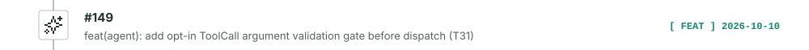
</picture>
</a>
<a href="https://github.com/agentic-ai-java/argi/pull/116">
<picture>
  <source media="(prefers-color-scheme: dark)" srcset="./assets/agentic-ai-java--argi-116-dark.svg">
  
</picture>
</a>
<a href="https://github.com/agentic-ai-java/argi/pull/115">
<picture>
  <source media="(prefers-color-scheme: dark)" srcset="./assets/agentic-ai-java--argi-115-dark.svg">
  
</picture>
</a>

[View all merged PRs in agentic-ai-java/argi →](https://github.com/agentic-ai-java/argi/pulls?q=is%3Apr+author%3Akonlue+is%3Amerged)

[View all merged Pull Requests →](https://github.com/pulls?q=is%3Apr+is%3Apublic+author%3Akonlue+-user%3Akonlue+is%3Amerged)
<!-- OPEN_SOURCE_PRS:END -->
