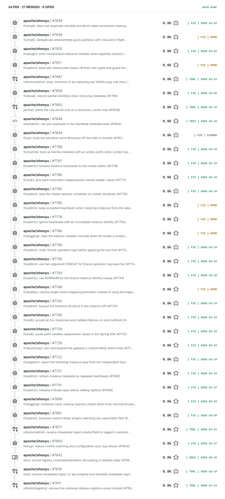
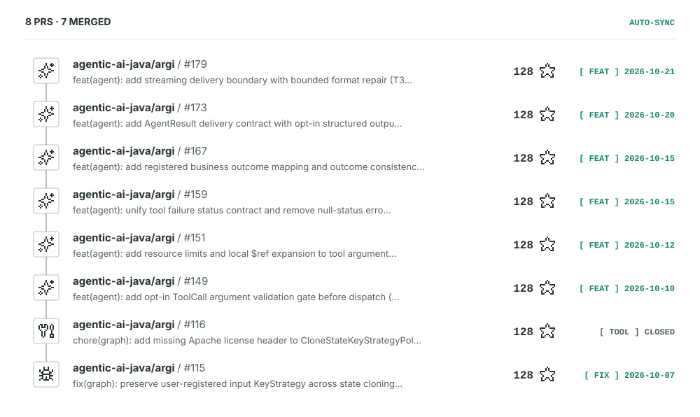

  <!-- title -->
  <a href="https://git.io/typing-svg">
    <picture>
      <source media="(prefers-color-scheme: dark)"
        srcset="https://readme-typing-svg.demolab.com?font=Fira+Code&weight=600&size=24&pause=1000&speed=40&color=58A6FF&width=700&height=50&center=true&lines=Hi%2C+I%27m+konlue.+Walking+in+AI+Full-Stack.&repeat=false&loop=false" />
      
    </picture>
  </a>

 

  <!-- Links -->
  
  <a href="mailto:yuxiaoyu.dev@gmail.com"><b>yuxiaoyu.dev@gmail.com</b></a>
  &nbsp;&nbsp;·&nbsp;&nbsp;
  
  <a href="https://konlue.github.io" target="_blank" rel="noopener"><b>https://konlue.github.io</b></a>

 

<h2 align="left">Contributing to</h2>

<!-- OPEN_SOURCE_PRS:START -->
> As of 2026-10-22: **42 PRs** submitted across **2 projects**, **34 merged**.

<h3 align="left">
  
  
</h3>

> **Apache ShenYu** — Java-native API gateway for service proxy, protocol conversion and API governance.

**What I did**: Bug fixes and reliability work across `admin` / `sdk` / `bootstrap` (instance heartbeats and cluster master election, Oracle compatibility, Netty event-loop lifecycle, SDK response handling), plus registry cleanup, dependency slimming and release notes. Currently working on plugin fault-tolerance eviction and K8s scaler wiring.

34 PRs · ✅ 27 merged · 🟡 6 open · ⛔ 1 closed &nbsp;(click to expand)

<a href="https://github.com/apache/shenyu/pulls?q=is%3Apr+author%3Akonlue+is%3Amerged">
<picture>
  <source media="(prefers-color-scheme: dark)" srcset="./assets/apache--shenyu-dark.svg">
  
</picture>
</a>

[View all merged PRs in apache/shenyu →](https://github.com/apache/shenyu/pulls?q=is%3Apr+author%3Akonlue+is%3Amerged)

<h3 align="left">
  
  
</h3>

> **ARGI** — Agent Runtime and Graph Intelligence: a Java agent framework built on Spring AI, with a graph runtime, multi-agent workflows and visual administration.

**What I did**: The opt-in ToolCall argument-validation gate (local JSON Schema `$ref` expansion, resource limits), a unified tool-failure status contract, the AgentResult delivery contract with structured-output finalizer, and a fix for user-registered KeyStrategy loss during state cloning. Currently working on streaming delivery boundaries.

8 PRs · ✅ 7 merged · ⛔ 1 closed &nbsp;(click to expand)

<a href="https://github.com/agentic-ai-java/argi/pulls?q=is%3Apr+author%3Akonlue+is%3Amerged">
<picture>
  <source media="(prefers-color-scheme: dark)" srcset="./assets/agentic-ai-java--argi-dark.svg">
  
</picture>
</a>

[View all merged PRs in agentic-ai-java/argi →](https://github.com/agentic-ai-java/argi/pulls?q=is%3Apr+author%3Akonlue+is%3Amerged)

[View all merged Pull Requests →](https://github.com/pulls?q=is%3Apr+is%3Apublic+author%3Akonlue+-user%3Akonlue+is%3Amerged)
<!-- OPEN_SOURCE_PRS:END -->
